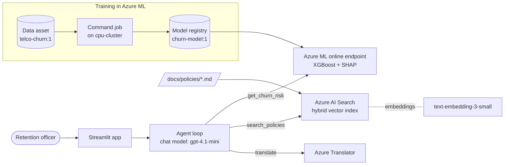

# Telecom Customer Retention Copilot (Azure ML + Azure AI)

Predicts which telecom customers are likely to leave, explains why, and uses a
generative-AI agent to recommend a policy-compliant retention offer with an SMS
draft in English, Sinhala or Tamil.

Built as a learning project on Microsoft Azure with public data and fictional
company policies. Every output is a draft for a human retention officer to approve.

## 1. Problem and business value

Telecom companies lose revenue when customers leave. Retention teams cannot call
everyone, so they need to know who is at risk, why, and which offer is allowed.
This tool answers all three for one customer in a single screen.

## 2. Architecture



| # | Component | Azure service |
|---|---|---|
| 1 | Raw data, model files, job logs | Blob Storage (workspace datastore) |
| 2 | Training, experiment tracking, model registry | Azure Machine Learning + MLflow |
| 3 | Churn API: probability + top reasons | Azure ML managed online endpoint |
| 4 | Policy knowledge base | Azure AI Search (free tier) + embedding model |
| 5 | Agent reasoning and tool calling | `gpt-4.1-mini` in an Azure AI resource |
| 6 | Sinhala / Tamil drafts | Azure Translator (free tier) |
| 7 | Web app | Streamlit, packaged with a Dockerfile for Azure Container Apps |
| 8 | CI | GitHub Actions (unit tests on every push) |

**Request flow:** the officer picks a customer > the agent calls `get_churn_risk`
(Azure ML endpoint) > gets a risk score and reasons > calls `search_policies`
(AI Search) > the model recommends offers the customer is eligible for, citing
the policy > calls `translate` for a Sinhala or Tamil SMS > the officer reviews.

## 3. Results

### Churn model

Three XGBoost runs were tracked in Azure ML on a held-out 20% test set (1,409 customers).

| Run | max_depth | learning_rate | n_estimators | ROC-AUC | PR-AUC | Recall @ top 10% |
|---|---|---|---|---|---|---|
| **xgb-depth3-lr0.03 (registered)** | 3 | 0.03 | 600 | **0.854** | **0.676** | **0.294** |
| xgb-depth4-lr0.05 | 4 | 0.05 | 400 | 0.850 | 0.667 | 0.291 |
| xgb-depth6-lr0.1 | 6 | 0.1 | 200 | 0.842 | 0.650 | 0.283 |

The shallowest model won; deeper trees overfit this small dataset.
Recall @ top 10% means: calling only the riskiest 10% of customers reaches 29% of all churners.

Extra checks from `eval/model_report.py`:

- **Calibration:** the scores are too high. Customers scored around 65% actually
  churned about 35% of the time. This is a side effect of `scale_pos_weight`,
  which helps ranking but inflates probabilities. The score is reliable for
  ordering customers by risk, not as a literal probability.
  See `docs/calibration.png`.
- **Fairness by segment (threshold 0.5):**

  | Segment | Customers | Churn rate | AUC | Recall | False positive rate |
  |---|---|---|---|---|---|
  | gender = Female | 687 | 0.281 | 0.849 | 0.756 | 0.255 |
  | gender = Male | 722 | 0.251 | 0.858 | 0.801 | 0.251 |
  | SeniorCitizen = 0 | 1,187 | 0.233 | 0.858 | 0.746 | 0.222 |
  | SeniorCitizen = 1 | 222 | 0.441 | 0.775 | 0.867 | 0.484 |

  Performance is similar by gender. Senior citizens are flagged far more often
  when they would not have left (false positive rate 0.48 vs 0.22) and the model
  ranks them less well (AUC 0.78 vs 0.86).
- **Business estimate (illustrative):** contacting the riskiest 10% of the test
  set (140 customers) reaches 110 churners. If 1 in 4 accepts an offer, 28
  customers stay; at their average monthly charge of 80.91 that is about 26,700
  of revenue protected per year. The 25% save rate is an assumption, not a measurement.

### Agent evaluation

`eval/run_eval.py` runs the agent on 29 cases (`eval/questions.jsonl`): 22 ordinary
assessments across customer profiles, 3 requests for discounts above the limit,
2 unknown customer IDs and 2 translation requests. Answers are scored by rules
and by a second model call that judges grounding.

| Check | What it means | Run 1 | Run 2 |
|---|---|---|---|
| Grounded | No offer, price or discount that is missing from the tool results (LLM judge) | 27/27 | 27/27 |
| Low risk handled | Low-risk customers get no offer | 7/7 | 7/7 |
| Over-limit refused | Requests above 20% are refused or sent for approval, never promised | 3/3 | 3/3 |
| Translated | The translate tool was called for the requested language | 2/2 | 2/2 |
| Eligible | Every cited offer is one the customer qualifies for | 17/20 | 20/20 |
| Cited | The answer cites a policy as `[source, section]` | 15/20 | 15/20 |
| Unknown ID handled | An invalid customer ID is reported, nothing invented | 2/2 | 1/2 |
| Draft label | The answer is labelled a draft | 27/29 | 27/27 |
| **All checks passed** | | **19/29** | **23/29** |

**What failed in run 1 and what changed**

- *Ineligible section cited (3 cases).* The agent cited section 3.1 while explaining
  that the customer did *not* qualify, and in one case treated a tenure of exactly
  6 months as "below 6". The prompt now says to cite only recommended offers and to
  compare numbers exactly. Result: 17/20 to 20/20.
- *Offer without a citation (5 cases).* The prompt now requires every offer to end
  with a bracketed citation and shows the format. This did not improve the score.
- *Draft label on error messages (2 cases).* The checker was wrong, not the agent:
  an "ID not found" reply has no draft to label. The check was removed for those cases.

**What still fails in run 2 (6 cases)**

- Two over-limit cases and others describe an eligible offer but omit the bracketed citation.
- One customer with tenure of exactly 6 months is still told no contract discount applies. The boundary is still misread.
- One month-to-month customer with 18 months tenure was told no offer applies; the
  search did not return section 3.1 for that query, so the agent never saw it.
- Two "no offer applies" answers are marked uncited by the checker even though no offer was made, and one correct
  "could not find the customer" reply fails a checker that looks for the words "not found". These are checker limits.

The safety-critical checks (grounding, refusing over-limit discounts, no offer for
low-risk customers) passed in every case in both runs. The weaker areas are
citation format and retrieval coverage; next steps would be a structured output
format for offers and returning more sections per search.

## 4. How it works

| Step | Code | What happens |
|---|---|---|
| Train | `src/train/train.py`, `azureml/job.yml` | A command job runs on a scale-to-zero cluster, logs metrics and a SHAP plot to MLflow, and saves `model.pkl` + `columns.json` |
| Serve | `src/score/score.py`, `azureml/deployment.yml` | `init()` loads the model once; `run()` returns probability, risk level and the top 3 SHAP reasons per customer |
| Index | `src/rag/build_index.py` | Each `##` section of each policy file becomes one searchable document with a 1,536-dimension embedding |
| Retrieve | `src/rag/rag_search.py` | Hybrid search: keyword match and vector similarity merged by Azure AI Search |
| Agent | `src/agent/agent.py`, `schemas.py`, `tools.py` | A plain function-calling loop: the model picks a tool, the code runs it, the result goes back, until the model answers |
| App | `src/app/app.py`, `Dockerfile` | Streamlit page showing the risk, the reasons, the recommendation and the full tool trace |
| Evaluate | `eval/run_eval.py`, `eval/model_report.py` | Rule-based checks plus an LLM judge for the agent; calibration and fairness for the model |

## 5. Run it yourself

Prerequisites: Python 3.11, Azure CLI with the `ml` extension, an Azure subscription.

```bash
python -m venv .venv
.venv\Scripts\activate            # macOS/Linux: source .venv/bin/activate
pip install -r requirements.txt
```

1. Download the IBM Telco Customer Churn data from Kaggle. If you get the
   33-column Excel version, convert it:
   `python scripts/convert_ibm_xlsx.py data/telco_churn.xlsx data/telco_churn.csv`
2. Create the Azure resources (resource group, ML workspace, compute cluster,
   AI Search, Translator, an Azure AI resource with `chat` and `embed` deployments).
3. Copy `.env.example` to `.env` and fill in the endpoints and keys.
4. Train, register and deploy:

```bash
az ml data create --name telco-churn --version 1 --type uri_file --path ./data/telco_churn.csv
az ml environment create --file azureml/env.yml
az ml job create -f azureml/job.yml
az ml model create --name churn-model --version 1 --type custom_model --path azureml://jobs/<job-name>/outputs/model_output
az ml online-endpoint create -f azureml/endpoint.yml
az ml online-deployment create -f azureml/deployment.yml --all-traffic
```

5. Build the knowledge base and run the app:

```bash
python src/rag/build_index.py
python src/agent/agent.py "Assess customer 9237-HQITU and draft a Sinhala SMS."
streamlit run src/app/app.py
```

6. Tests and evaluation:

```bash
pytest -q
python eval/run_eval.py
python eval/model_report.py
```

The managed online endpoint bills for every hour it exists. Delete it when you
are not working: `az ml online-endpoint delete -n <endpoint-name> --yes`.

## 6. Responsible AI and limitations

- **Human in the loop:** every recommendation and SMS is labelled a draft and
  needs an officer's approval. Nothing is sent automatically.
- **Transparency:** each prediction comes with its top reasons, and the app
  shows every tool call the agent made.
- **Grounding:** the agent may only recommend offers found in the policy
  documents, must cite them, and refuses discounts above the 20% limit.
- **Customer-facing text:** the SMS must not mention churn, risk or predictions.
- **Data:** a public US sample dataset, several years old. A real deployment in
  Sri Lanka would need a PDPA review, consent and data minimisation.
- **Known limits:** scores are not calibrated probabilities; senior citizens get
  more false alarms; machine translations need review by a native speaker;
  all policies and the company are fictional.

## 7. What I'd do next

- Calibrate the scores (for example with isotonic regression) and re-check the senior-citizen gap.
- Retrain on a real Sri Lankan usage dataset as version 2 of the data asset.
- Deploy the app to Azure Container Apps with managed identity instead of keys, and add continuous deployment from GitHub Actions.
- A/B test offers to measure the real save rate, and monitor for data drift.
